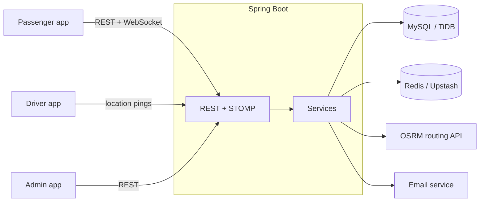

# BusTrackr

Real-time bus tracking and transport management platform for **public and private transport systems** (city buses, schools, colleges). Admins manage the transport system (routes, trips, drivers, buses and members) and can track all buses at once as well as any individual bus, drivers run trips and share their live location, and passengers search, see upcoming trips and track buses on a map.

**Live demo:** https://bustracker-eta-ten.vercel.app/
**Repository:** https://github.com/mohitsingh-makwana/bustracker

> The backend runs on a free Render instance, so the first request after a quiet period can take up to a minute while it wakes up.

---

## Features

### Passengers
- Browse all transport systems; public systems open without login, private systems need an approved membership
- Search trips by route, stop and time range
- One merged list of live and upcoming trips (single and regular), with trip details (bus, driver, timing)
- Live bus tracking on a map with the latest position, next stop and distance

### Drivers
- See assigned single and regular trips and start a trip
- Live location sharing from the browser (Geolocation API)
- Full route pattern on the map with the next stop and distance to the next stop and destination

### Admins
- Create and manage stops, routes, route patterns (ordered stops with arrival times), buses, drivers and members
- Create single trips and recurring trip schedules (pattern + driver + bus)
- Approve or reject access requests and assign roles (passenger, driver, admin)
- Dashboard summary: trips today by status, live buses, available drivers, pending requests
- Live map of **all buses of the transport system at once** over WebSocket, with the option to open and track an individual bus

### Platform
- Email OTP verification before account creation
- Role-based access control with separate user and member tokens
- Soft delete (records are kept, no reactivation)

---

## Tech stack

| Layer | Technology |
|---|---|
| Backend | Java 21, Spring Boot, Spring Security, Spring Data JPA / Hibernate |
| Frontend | React, Leaflet / react-leaflet |
| Database | MySQL (TiDB Cloud in production) |
| Cache / live state | Redis (Upstash in production) |
| Real-time | WebSocket with STOMP |
| Auth | JWT (stateless) |
| Routing | OSRM (public routing API) |
| Email | SMTP email service for OTP |
| DevOps | Docker, Git, GitHub |
| Hosting | Vercel (frontend), Render (backend) |

---

## Architecture



### Live tracking flow
1. The driver starts a trip. The backend stores the trip metadata in Redis (route pattern, destination, start/destination coordinates, total route distance).
2. The driver's browser sends a location ping about every 5 seconds.
3. For each accepted ping the server validates the next stop (forward-only), calculates distance and speed, updates the live state in Redis and appends a row to `LocationHistory` in MySQL.
4. The updated location is published over WebSocket, and passengers receive a snapshot first and then the live stream.
5. Admins subscribe to the system-wide live-buses topic to see every active bus on one map, and can switch to a single trip's topic to track one bus.
6. If the WebSocket connection drops, the client reconnects with a fresh token and fetches the latest snapshot.

### Domain model (main entities)
`User`, `TransportSystem`, `TransportMember` (status: pending / active / rejected, role: passenger / driver / admin), `Driver`, `Bus`, `Stop`, `Route`, `RoutePattern`, `PatternStop`, `TripSchedule` (recurring), `Trip` (a real journey), `LocationHistory`

- A route can have several patterns (for example the same start and end with different intermediate stops).
- A `Trip` is created only when a trip actually starts (or directly for a single trip); recurring trips come from a `TripSchedule` plus a service date.
- Driver and bus availability is a status field (`AVAILABLE`, `ON_TRIP`, `NOT_AVAILABLE`) updated through one trip lifecycle service.

### Security
- **User token**: issued at login, identifies the account.
- **Member token**: issued when the user selects a transport system; carries the member id, system id and role, and is used for role-based endpoints.
- Secure by default: every endpoint requires authentication unless explicitly opened (for example public transport data).
- Method-level checks with `@PreAuthorize` and a transport-system guard.

---

## API overview

Base path: `/api/v1`

| Area | Examples |
|---|---|
| Auth | `register`, `login`, `refresh`, `me`, `select-system`, send OTP, verify OTP |
| Transport systems | list public and private systems, membership requests, approve / reject |
| Trips (driver) | `POST trips/my/{id}/start`, `GET trips/my/current` |
| Trips (shared) | `GET trips/{id}/stops`, `POST trips/{id}/locations`, `GET trips/{id}/live-location` |
| Admin | dashboard summary, CRUD for stops, routes, patterns, buses, drivers, members, trips |

**WebSocket (STOMP)**

| Destination | Purpose |
|---|---|
| `/api/v1/ws` | Connection endpoint |
| `/app/trips/{tripId}/locations` | Driver publishes location |
| `/topic/trips/{tripId}/location` | Passengers subscribe to one trip |
| `/topic/transport-systems/{id}/live-buses` | All live buses of a transport system (admin map) |

---

## Getting started

### Prerequisites
- Java 21 and Maven
- Node.js 18+
- MySQL 8 (or a TiDB / MySQL-compatible database)
- Redis
- An SMTP account for sending OTP emails (for example a Gmail app password)

### 1. Clone
```bash
git clone https://github.com/mohitsingh-makwana/bustracker.git
cd bustracker
```

### 2. Configure the backend
Create a `.env` file (or set these as environment variables). Leave the secrets empty in the repository and fill them in locally.

```env
# MySQL
MYSQL_DATABASE=bustrackr
MYSQL_USERNAME=root
MYSQL_USER=bustrackr_user
MYSQL_PASSWORD=
MYSQL_ROOT_PASSWORD=
MYSQL_HOST=localhost
MYSQL_PORT=3306

# Redis
REDIS_HOST=localhost
REDIS_PORT=6380

# CORS / WebSocket origins (comma separated)
ALLOWED_ORIGINS=http://localhost:5173,http://localhost:3000

# Email (OTP)
MAIL_USERNAME=
MAIL_PASSWORD=

# JWT
JWT_SECRET=
JWT_EXPIRATION_MS=3600000
USER_VERIFICATION_SECRET=

# OSRM routing
OSRM_BASE_URL=https://router.project-osrm.org
OSRM_PROFILE=driving
OSRM_CONNECT_TIMEOUT=2s
OSRM_READ_TIMEOUT=5s
OSRM_MAX_RETRIES=2
OSRM_RETRY_DELAY=500ms
OSRM_CACHE_TTL=24h
```

| Variable | Purpose |
|---|---|
| `MYSQL_*` | Database connection (`MYSQL_USER`, `MYSQL_PASSWORD` and `MYSQL_ROOT_PASSWORD` are also used when MySQL runs in Docker) |
| `REDIS_HOST`, `REDIS_PORT` | Redis for live trip state and OTP storage |
| `ALLOWED_ORIGINS` | Frontend origins allowed for CORS and the WebSocket handshake |
| `MAIL_USERNAME`, `MAIL_PASSWORD` | Account used to send OTP emails (use an app password) |
| `JWT_SECRET`, `JWT_EXPIRATION_MS` | Signing key and lifetime (1 hour by default) of access tokens |
| `USER_VERIFICATION_SECRET` | Separate signing key for the short-lived email verification token |
| `OSRM_*` | Routing API address, profile, timeouts, retries and cache lifetime |

### 3. Run the backend
```bash
cd backend
./mvnw spring-boot:run
```
The API is served at `http://localhost:8080/api/v1`.

### 4. Run the frontend
```bash
cd frontend
npm install
npm run dev
```
Point the frontend to the backend with its environment file (for example `VITE_API_URL=http://localhost:8080/api/v1` and the matching `ws://localhost:8080/api/v1/ws` URL).

### Docker
```bash
docker build -t bustrackr-backend ./backend
docker run -p 8080:8080 --env-file .env bustrackr-backend
```

---

## Deployment

| Part | Platform |
|---|---|
| Frontend (React) | Vercel |
| Backend (Spring Boot, Docker) | Render |
| Redis | Upstash |
| MySQL | TiDB Cloud |

In production, set the allowed CORS and WebSocket origins to the Vercel domain and use `wss://` for the WebSocket URL.

---

## Notes and limitations

- OSRM uses the public demo server, which has usage limits and no uptime guarantee. Calls use timeouts, retries and a cache (see the `OSRM_*` settings), and self-hosting OSRM is the production option.
- The backend runs on a free tier, so it can be slow on the first request after idle time.
- Browsers do not report GPS speed reliably, so speed is derived from a window of location fixes.

## Roadmap

- Self-hosted OSRM
- Notifications when a bus is near a stop
- Passenger "I'm arriving" signal to the driver
- Caching and query optimization (N+1, indexes)

---

## Author

**Mohit Singh Makwana** – B.Tech CSE (Cyber Security), AITR Indore
Backend built by me with Spring Boot; the React frontend was built with AI assistance.

GitHub: https://github.com/mohitsingh-makwana
LinkedIn: https://www.linkedin.com/in/mohit-singh-makwana18
